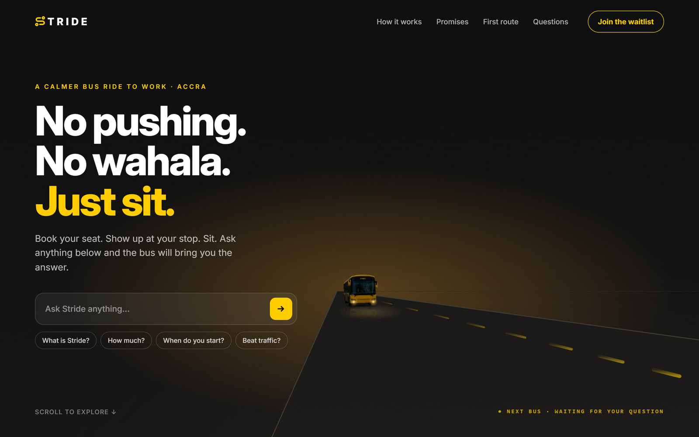
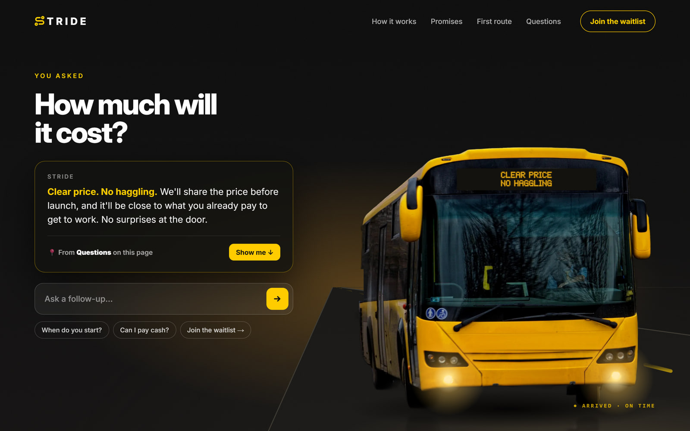
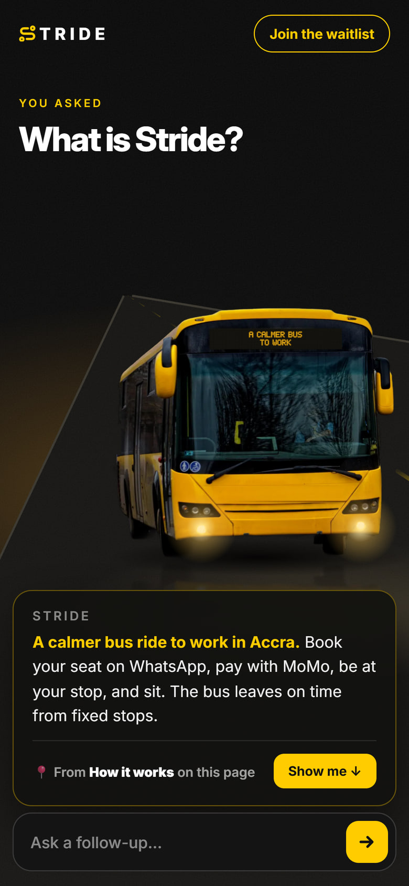

# Stride

**A calmer bus ride to work in Accra.** No pushing. No wahala. Just sit.

Stride is a planned commuter bus for Accra: book your seat, be at your stop, and sit for the whole ride. The bus leaves on time from fixed stops. **Clear price. No haggling.**

🔗 **Live site:** _coming soon_ <!-- replace with the live link, e.g. https://<name>.vercel.app -->

## The website

Ask a question and the Stride bus drives up the road to bring the answer. Its LED sign shows the short answer and the full one appears beside it, with a link to the part of the page it came from.

  

## Built with

- [Next.js](https://nextjs.org) (React)
- [Framer Motion](https://motion.dev) for the bus and road animation
- Hosted on [Vercel](https://vercel.com)

---

© 2026 Stride · Accra, Ghana · Instagram · TikTok · @ridestride.gh
